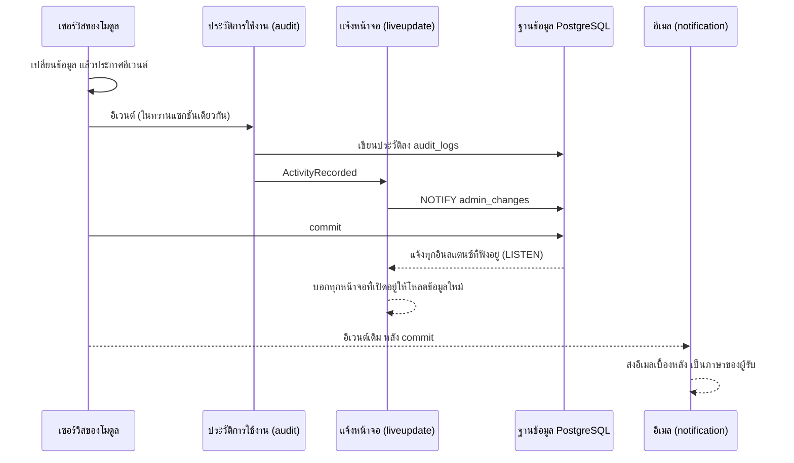

# 01 — ภาพรวม

`admin-api-starter` คือระบบหลังบ้านของ [admin-ng-starter](../../admin-ng-starter) ทำครบทุกข้อตามสัญญาใน [`API.md`](../../admin-ng-starter/src/app/user-management/API.md) ตัวระบบเป็นแอปเดียว แต่แบ่งเป็นโมดูลที่แยกจากกันเหมือนเป็นคนละบริการ แต่ละโมดูลเป็นเจ้าของตารางของตัวเอง และติดต่อโมดูลอื่นได้แค่สองทาง คือเรียกเซอร์วิสที่เปิดให้ใช้ หรือฟังอีเวนต์ที่อีกฝ่ายประกาศ ทุกครั้งที่ build จะมีเทสต์ (ArchUnit) ตรวจว่าไม่มีใครข้ามกฎนี้

ไฟล์นี้อธิบายว่าชิ้นส่วนต่าง ๆ ต่อกันอย่างไร ตำแหน่งของทุกไฟล์อยู่ใน [trees/BACKEND.md](../trees/BACKEND.md) เหตุผลของแต่ละการตัดสินใจอยู่ใน [02-DECISIONS.md](02-DECISIONS.md) และการดูแลระบบหลังนำขึ้นใช้งานจริงอยู่ใน [OPERATIONS.md](OPERATIONS.md)

## โมดูล

ทุกโมดูลอยู่ใต้ `com.adminstarter.accesscontrol` ภายในแต่ละโมดูลแบ่งเป็นชั้น (`controller`, `service`, `repository`, `entity`, `dto`, `event`, `policy`, `spi`) โมดูลอื่นใช้ได้เฉพาะชั้น `service`, `dto`, `event` และ `spi` (กฎ R2) และโมดูลห้ามพึ่งพากันเป็นวง (กฎ R8)

| โมดูล | เป็นเจ้าของ | เรียกเซอร์วิสของ | ฟังอีเวนต์ของ |
| --- | --- | --- | --- |
| `authorization` | บทบาท, รายการสิทธิ์ (อ่านจากโค้ดทุกครั้งที่เริ่มระบบ), กฎ "ห้ามให้สิทธิ์เกินที่ตัวเองมี" (`GrantPolicy`), บทบาทที่ห้ามถือร่วมกัน | — | — |
| `branch` | สาขา | — | — |
| `settings` | ทุกค่าในหน้าตั้งค่า (`AdminSettings`) | authorization | authorization (บทบาทถูกลบ ก็เอาออกจาก `twoFactorRoleIds`) |
| `identity` | ผู้ใช้, รหัสผ่าน, การยืนยันตัวตนสองขั้นตอน, รหัสสำรอง, การมอบบทบาท | authorization, branch, settings | — |
| `authentication` | การเข้าสู่ระบบ, คุกกี้สำหรับต่ออายุการเข้าสู่ระบบ, เซสชันของแต่ละอุปกรณ์, การยืนยันตัวตนซ้ำ, ลิงก์ในอีเมล | identity, settings | identity (ผู้ใช้ถูกระงับหรือเปลี่ยนรหัสผ่าน ก็ปิดเซสชัน, ถูกเชิญหรือถูกรีเซ็ตรหัสผ่าน ก็สร้างลิงก์ในอีเมล) |
| `review` | รอบทบทวนสิทธิ์ | identity, authorization, branch, settings | — |
| `notification` | อีเมล | identity, authorization, branch, settings | identity, authentication, review |
| `audit` | ประวัติการใช้งาน | — | ทุกโมดูล |
| `liveupdate` | การแจ้งหน้าจอให้โหลดข้อมูลใหม่ทันที (SSE ที่ `/api/events`) | — | audit (เฉพาะ `ActivityRecorded`) |

นอกจากโมดูลยังมีแพ็กเกจอีกสี่ส่วน ได้แก่

- `security` ตัวเชื่อมกับ Spring Security ทำหน้าที่แปลงโทเค็นเป็นผู้กระทำ (`Actor`)
- `config` ประกอบชิ้นส่วนเข้าด้วยกันอย่างเดียว ไม่มีตรรกะของระบบ
- `common` ของที่ทุกโมดูลใช้ร่วมกัน เช่น `ErrorCode`, `Actor`, `RequestContext`, `ApiExceptionHandler`
- `AccessControlProperties` ค่าตั้งของระบบทั้งหมด

ส่วนงานเฉพาะของโปรเจกต์อยู่ใต้ `com.adminstarter.app` ซึ่ง `accesscontrol` ห้ามอ้างถึง (กฎ R1)

## คำขอหนึ่งครั้งผ่านอะไรบ้าง

1. `RequestContextFilter` จำว่าคำขอนี้มาจากไหน (IP, เบราว์เซอร์, ระบบปฏิบัติการ) และใส่รหัสคำขอ (`request_id`) ลงในทุกบรรทัดของ log
2. `RateLimitFilter` นับจำนวนคำขอต่อ IP เฉพาะ `/api/auth/*` และ `/api/me/reauthenticate` ถ้าเกินจะตอบ 429
3. Spring Security ตรวจลายเซ็นและอายุของโทเค็น จากนั้น `PermissionAuthenticationConverter` ตรวจสิ่งที่โทเค็นไม่ได้บอก คือเซสชันยังเปิดอยู่ไหม บัญชียังใช้งานได้ไหม ตอนนี้บทบาทไหนยังมีผล และรวมกันแล้วได้สิทธิ์อะไร (ในโทเค็นมีแค่รหัสผู้ใช้ `sub` กับรหัสเซสชัน `sid` ไม่มีสิทธิ์อยู่ข้างใน) เซสชันที่ปิดไปแล้วหรือบัญชีที่ถูกระงับจึงถูกปฏิเสธ (401) ทันที ไม่ต้องรอโทเค็นหมดอายุ
4. `TwoFactorSetupFilter` คนที่ถือบทบาทที่บังคับการยืนยันตัวตนสองขั้นตอนแต่ยังไม่ได้เปิด จะทำได้แค่ขั้นตอนเปิดใช้ อย่างอื่นตอบ 403 `two_factor_mandatory`
5. controller ทุกเมธอดมี `@PreAuthorize("hasAuthority('…')")` (กฎ S1) และไม่มีตรรกะของระบบ
6. service เปิดทรานแซกชัน (กฎ R10) และตรวจกฎที่ละเอียดกว่าสิทธิ์ ซึ่งอยู่ใน `policy/` และใน service เอง เช่น ห้ามให้สิทธิ์เกินที่ตัวเองมี, ต้องเหลือผู้ดูแลสูงสุดอย่างน้อยหนึ่งคน (`last_administrator`), ขอบเขตของสาขา และการยืนยันตัวตนซ้ำก่อนทำเรื่องเสี่ยง (`Actor.requireRecentSignIn()`)
7. ถ้าถูกปฏิเสธ service จะโยน `AccessControlException` แล้ว `ApiExceptionHandler` ตอบกลับในรูปแบบ ProblemDetail ที่มี `code` ตาม API.md และ `requestId`

## การเปลี่ยนแปลงข้อมูลหนึ่งครั้ง

ทุกการเปลี่ยนแปลงต้องประกาศอีเวนต์ สิ่งที่ตามมาแบ่งเป็นสองช่วง คือระหว่างทรานแซกชัน และหลังบันทึกลงฐานข้อมูลสำเร็จ (commit)

- **ระหว่างทรานแซกชัน:** การเขียนประวัติการใช้งาน (`AuditListener`), การแจ้งหน้าจอ (`NOTIFY`) และผลที่ตามมาในโมดูลอื่น เช่น ปิดเซสชันของคนที่ถูกระงับ ทั้งหมดสำเร็จหรือยกเลิกไปพร้อมกัน จึงไม่มีการเปลี่ยนแปลงไหนที่ไม่มีประวัติ และไม่มีประวัติของการเปลี่ยนแปลงที่ถูกยกเลิก
- **หลัง commit:** อีเมล (`notification`) ส่งอยู่เบื้องหลัง ถ้าส่งไม่ได้จะเขียนลง log แต่ไม่ส่งใหม่ และการเปลี่ยนแปลงที่ถูกยกเลิกจะไม่มีอีเมล
- งานที่ระบบรันเองตามเวลา เช่น ระงับบัญชีที่ไม่ได้ใช้ หรือปิดรอบทบทวนสิทธิ์ ก็เปลี่ยนข้อมูลผ่านเส้นทางเดียวกันนี้ (รายการงานอยู่ใน [OPERATIONS.md](OPERATIONS.md))

## ข้อมูลอยู่ที่ไหน

| ข้อมูล | อยู่ที่ |
| --- | --- |
| ผู้ใช้, บทบาท, การมอบบทบาท, สาขา, เซสชัน, โทเค็นต่ออายุ (เก็บเป็นค่า hash SHA-256), ประวัติการใช้งาน, การตั้งค่า, รอบทบทวนสิทธิ์ | PostgreSQL สคีมา `access_control` (ไฟล์ migration ของ Flyway ใน `db/migration/access_control`) |
| ข้อมูลของงานเฉพาะโปรเจกต์ | PostgreSQL สคีมา `app` (ไฟล์ migration ใน `db/migration/app`) |
| สิทธิ์ที่รวมแล้ว, ข้อมูลบัญชี, บทบาทที่บังคับการยืนยันตัวตนสองขั้นตอน, เวลาที่ยืนยันตัวตนล่าสุด, เวลาที่เซสชันใช้งานล่าสุด | แคช (Caffeine) ในหน่วยความจำของแต่ละอินสแตนซ์ หมดอายุใน 60 วินาที และถูกล้างหลัง commit ของการเปลี่ยนแปลงบนอินสแตนซ์นั้น |
| การเชื่อมต่อของหน้าจอที่รอฟังการเปลี่ยนแปลง (SSE) | หน่วยความจำของอินสแตนซ์ที่เบราว์เซอร์ต่ออยู่ |
| โทเค็นสำหรับเรียก API (access token) | หน่วยความจำของเบราว์เซอร์เท่านั้น |
| โทเค็นต่ออายุ (refresh token) | คุกกี้แบบ `HttpOnly` ในเบราว์เซอร์ และค่า hash ในฐานข้อมูล |
| คีย์เซ็นโทเค็น และคีย์เข้ารหัสข้อมูลลับในฐานข้อมูล | ตัวแปรสภาพแวดล้อม (`AC_JWT_*`, `AC_ENCRYPTION_*`) |

## เพิ่มของใหม่

- **ฟีเจอร์ของงานเฉพาะโปรเจกต์:** ใช้ `tools/new-module.sh` สร้างโมดูลใต้ `app/` แล้วประกาศสิทธิ์ใน `AppPermissions`, ใส่ไฟล์ migration ใน `db/migration/app`, ใส่ `@PreAuthorize` ทุก endpoint และใช้ `Actor.can(permission, branchId)` เมื่อสิทธิ์ขึ้นกับสาขา
- **เปลี่ยนสัญญา API:** แก้ API.md, `HttpAdminApi`, `localBackend` และระบบหลังบ้านนี้พร้อมกัน แล้วรัน `python tools/api-coverage.py`
- **ตัดสินใจเรื่องที่ขัดกับของเดิม:** เพิ่มบันทึกการตัดสินใจข้อใหม่ใน [02-DECISIONS.md](02-DECISIONS.md) ที่อ้างถึงข้อเดิม ห้ามแก้ข้อเดิมเงียบ ๆ
- **ก่อนบอกว่าเสร็จ:** รันการตรวจโครงสร้างและ `./mvnw verify` (คำสั่งอยู่ใน [README](../README.md))
